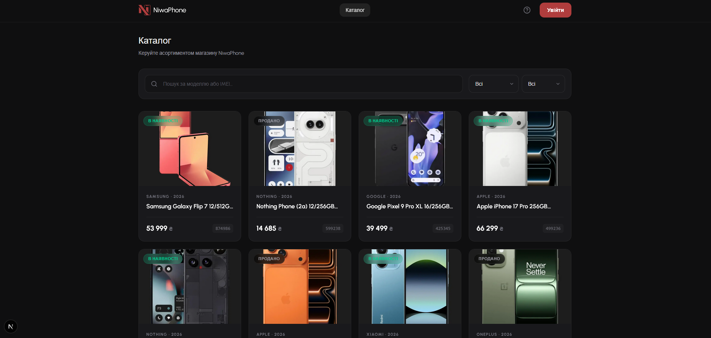
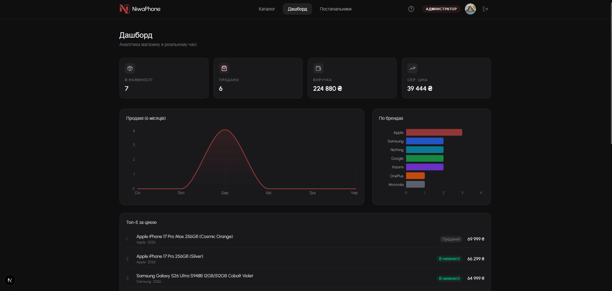
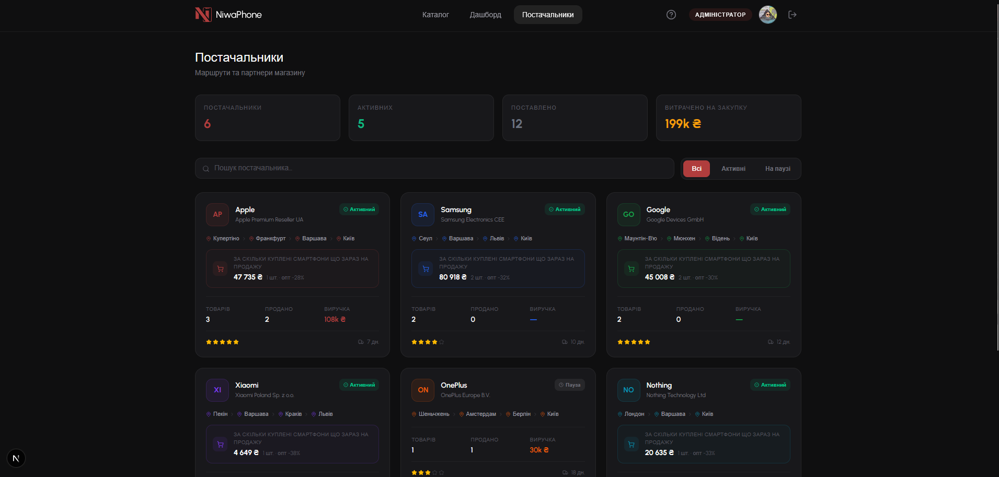
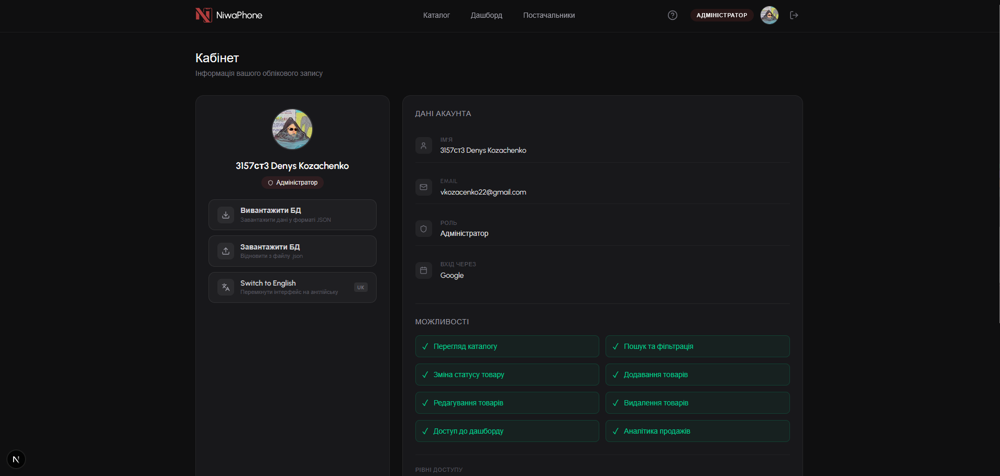
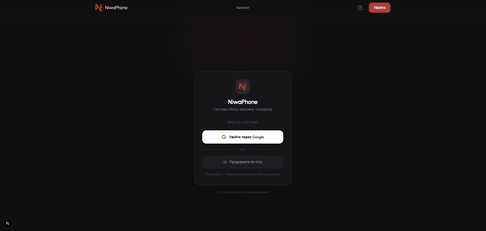
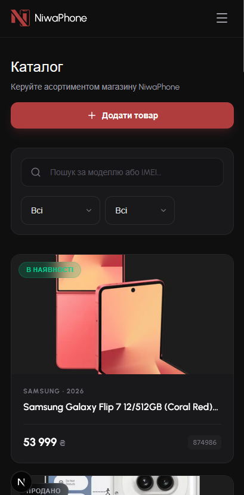
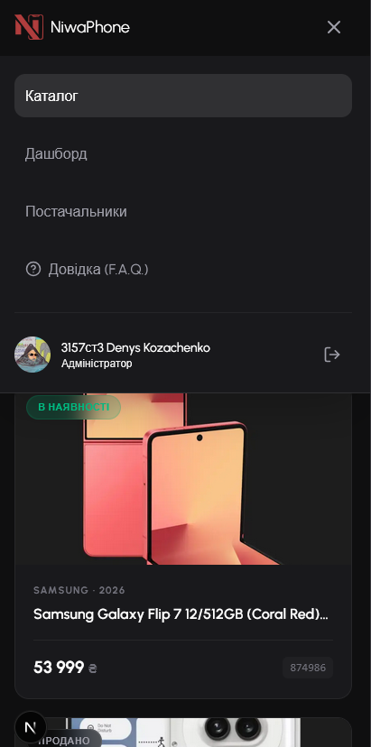
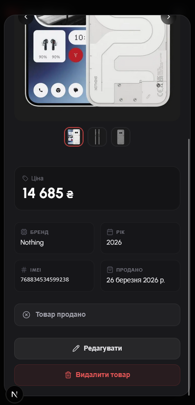

  <h1>
     
    NiwaPhone
  </h1>

  
  
  
  
  

   
   
  

---

## 📱 Про проєкт

**NiwaPhone** - це сучасна автоматизована система (web-додаток) для управління асортиментом та обліку товарів у магазині електроніки.
Проєкт розроблено з метою оптимізації робочих процесів, контролю наявності смартфонів та глибокої аналітики продажів.

### Основні можливості:
- **Каталог товарів:** Зручне додавання, редагування, видалення та пошук смартфонів за моделлю, брендом або унікальним IMEI.
- **Керування продажами:** Швидка зміна статусу товару ("в наявності" / "проданий") з автоматичним фіксуванням дати продажу.
- **Панель аналітики (Dashboard):** Візуалізація ключових показників (дохід, кількість проданих товарів, середній чек) та інтерактивні графіки продажів за брендами й місяцями.
- **База постачальників:** Облік закупівель, розрахунок оптових знижок, маржинальності та контроль статусів доставки.
- **Розмежування доступу:** Безпечна авторизація через Google із розподілом ролей (Адміністратор, Продавець, Гість) для захисту комерційної інформації.

---

## Скріншоти

| Головна | Дашборд | Постачальники |
|---|---|---|
|  |  |  |

| Особистий кабінет | Вхід до системи |
|---|---|
|  |  |

### Мобільна версія

| Головна | Бокове меню | Сторінка товару |
|---|---|---|
|  |  |  |

---

## Ліцензія

Проєкт ліцензовано згідно з **GNU Affero General Public License v3.0** (AGPL-3.0).
Деталі дивіться у файлі [LICENSE](LICENSE).