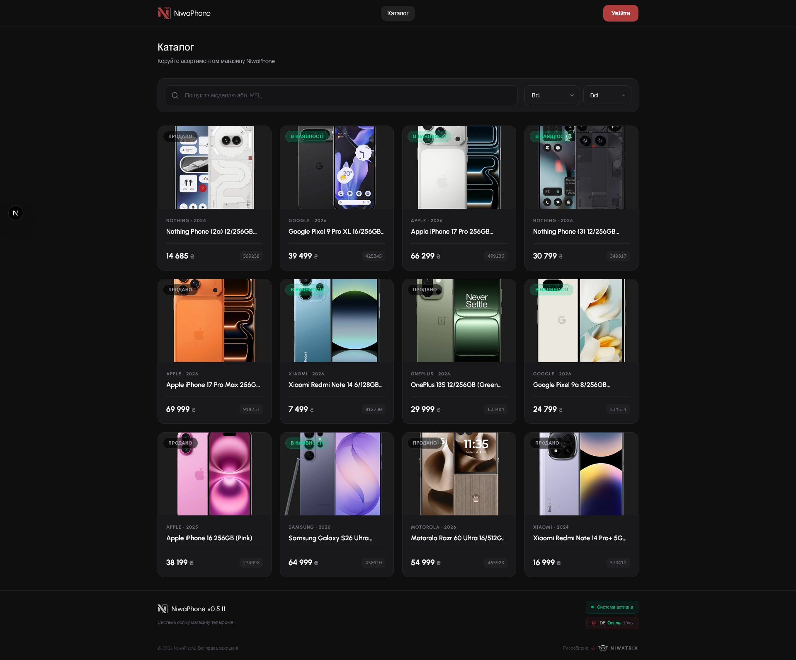

<div align="center">
  <h1>
     
    NiwaPhone
  </h1>

  
  
  
  
  

  <br />
  <br />

  **[🇺🇦 Українська](#ukrainian) | [🇬🇧 English](#english)**

  <br />

  
  
</div>

---

<a id="ukrainian"></a>
## 📱 Про проєкт

**NiwaPhone** — це сучасна автоматизована система (web-додаток) для управління асортиментом та обліку товарів у магазині електроніки. Проєкт розроблено з метою оптимізації робочих процесів, контролю наявності смартфонів та глибокої аналітики продажів.

### Основні можливості:
- **Каталог товарів:** Зручне додавання, редагування, видалення та пошук смартфонів за моделлю, брендом або унікальним IMEI.
- **Керування продажами:** Швидка зміна статусу товару ("в наявності" / "проданий") з автоматичним фіксуванням дати продажу.
- **Панель аналітики (Dashboard):** Візуалізація ключових показників (дохід, кількість проданих товарів, середній чек) та інтерактивні графіки продажів за брендами й місяцями.
- **База постачальників:** Облік закупівель, розрахунок оптових знижок, маржинальності та контроль статусів доставки.
- **Розмежування доступу:** Безпечна авторизація через Google із розподілом ролей (Адміністратор, Продавець, Гість) для захисту комерційної інформації.

---

<a id="english"></a>
## 📱 About the project

**NiwaPhone** is a modern automated system (web application) for managing the assortment and inventory of an electronics store. The project was developed to optimize workflows, control the availability of smartphones, and provide deep sales analytics.

### Key features:
- **Product Catalog:** Conveniently add, edit, delete, and search for smartphones by model, brand, or unique IMEI.
- **Sales Management:** Quickly change the product status ("in stock" / "sold") with automatic recording of the sale date.
- **Analytics Dashboard:** Visualization of key metrics (revenue, number of products sold, average order value) and interactive sales charts by brands and months.
- **Supplier Database:** Track purchases, calculate wholesale discounts and margins, and monitor delivery statuses.
- **Access Control:** Secure authorization via Google with role-based access control (Administrator, Seller, Guest) to protect commercial information.

---

```text
Licensed under the **GNU Affero General Public License v3.0** (AGPL-3.0).
See the [LICENSE](LICENSE) file for details.